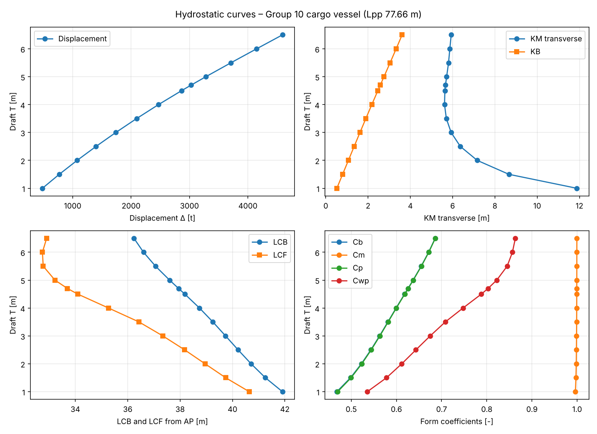
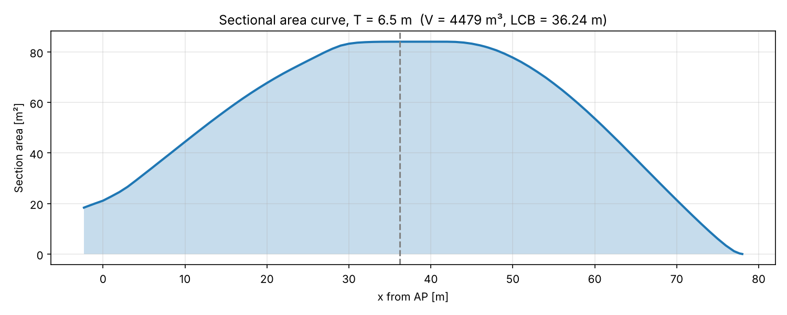

# Ship Hydrostatics in Python

Python script that calculates the hydrostatics of a ship hull from an offset
table exported from DELFTship, and checks the results against DELFTship's own
hydrostatics report.

The hull is the 77.66 m cargo vessel from our ship design project
(NTNU Marine Technology, group 10), at a design draft of 6.5 m.

## What it calculates

- Displacement, volume, LCB and KB, by integrating waterplane areas with Simpson's rule
- Waterplane area, LCF and second moments of area (transverse and longitudinal)
- BM and KM, both transverse and longitudinal
- Form coefficients Cb, Cm, Cp and Cwp
- Hydrostatic curves for drafts from 1 to 6.5 m
- Sectional area curve
- A cross-check of the volume: it is integrated once over waterplanes and once over section areas

## Results vs. DELFTship (T = 6.5 m)

| Quantity | Python | DELFTship | Diff |
|---|---|---|---|
| Displacement [t] | 4591 | 4568 | +0.50 % |
| LCB [m] | 36.24 | 36.22 | +0.06 % |
| Waterplane area [m²] | 867.5 | 867.6 | −0.02 % |
| LCF [m] | 32.90 | 32.91 | −0.01 % |
| KM transverse [m] | 5.93 | 5.96 | −0.49 % |
| Cb | 0.686 | 0.682 | +0.50 % |

All values agree within about 0.5 %. The small remaining difference comes
mainly from the keel. The DELFTship export starts at the 0.5 m waterline, so
the half-breadth at z = 0 has to be extrapolated.




## How to run

```bash
pip install -r requirements.txt
python main.py
```

The plots and the comparison table are saved in `results/`.

## Files

- `offsets.py`: reads the DELFTship offset file (handles decimal commas and the file header)
- `hydrostatics.py`: the hydrostatic calculations
- `main.py`: runs everything, compares the results with DELFTship and makes the plots
- `data/`: the offset table exported from DELFTship
